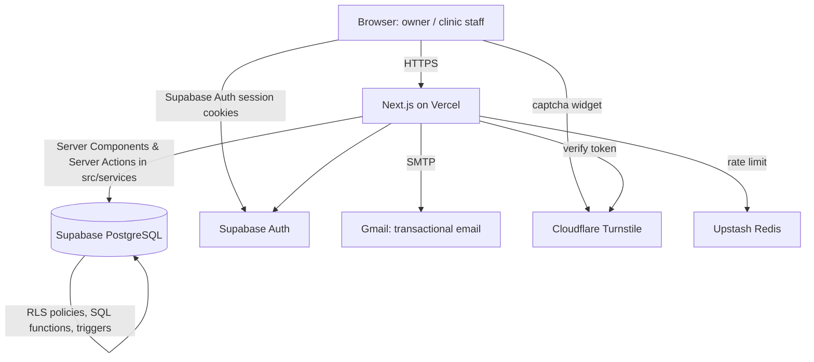
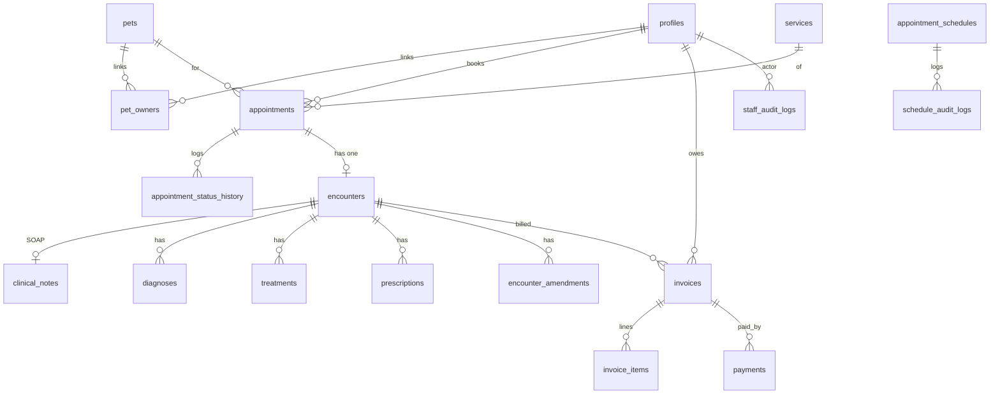

# E-VetDoc — Overall System Knowledge Base

> **What this file is:** the single, complete description of the E-VetDoc system as of
> **October 30, 2026**: what it does, who uses it, how it works, and how it is built.
> It is written to be pasted into an AI assistant (ChatGPT, Claude, Gemini, …) to produce
> slide decks, research papers (Chapters 1–5), user manuals, or presentations.
> Part A is non-technical; Part B is technical. Part C collects rules, statuses, and terms.
>
> **Tip for AI use:** paste the whole file, then ask e.g. *"Using this knowledge base, write
> Chapter 3 (Methodology/System Design) of our thesis"* or *"Make a 12-slide defense deck"*.
> Everything here describes the real, implemented system; "Limitations" lists what it does not do.

---

## Table of contents

- Part A — Non-technical
  1. Overview
  2. The problem and objectives
  3. Users and roles
  4. Features by module
  5. Main workflows (step by step)
- Part B — Technical
  6. Technology stack
  7. Architecture
  8. Data model
  9. Security model
  10. Automation in the database
  11. Testing and quality assurance
  12. Deployment and configuration
- Part C — Reference
  13. Business rules
  14. Status lifecycles
  15. Limitations and future work
  16. Revision history
  17. Glossary
  18. Document map

---

# Part A — Non-technical

## 1. Overview

**E-VetDoc** is a web-based veterinary clinic management system for **one clinic**. It puts the
clinic team and pet owners in one secure place to:

- register and approve accounts,
- manage pets and their owners,
- book appointments online with automatic confirmation and a daily booking limit,
- record consultations (SOAP notes, diagnoses, treatments, prescriptions) and lock them when signed,
- bill visits with BIR-style VAT breakdowns, record payments, and print official receipts,
- keep an audit trail (logs) of everything important that happens.

It runs in any modern browser (desktop or phone). Live site: <https://e-vetdoc-five.vercel.app>.

**One-line pitch:** *From booking to diagnosis to receipt — one connected, role-based record of
every pet's care at the clinic.*

## 2. The problem and objectives

**Problem.** Small veterinary clinics often run on paper logbooks, chat messages, and separate
receipts. Appointments get double-booked, pet histories are scattered, owners cannot see their
pets' records, and there is no reliable trail of who changed what.

**General objective.** Build a secure web system that connects appointments, medical records,
and billing for a single veterinary clinic.

**Specific objectives (as implemented).**
1. Role-based access for Admin, Staff, Veterinarian, and Owner, with clinic approval of new accounts.
2. Online booking that confirms instantly while the day has room and blocks bookings once full.
3. Electronic medical records in SOAP format that are locked after signing (amendments only).
4. Integrated billing with VAT computation, invoice/receipt numbering, and printable receipts.
5. A complete audit log of appointment, clinical, billing, staff, schedule, and account changes.
6. Privacy: owners see only their own pets, visits, records, and invoices.

## 3. Users and roles

The system has **four roles**. Everyone signs up choosing a role; the clinic approves it.
("Client" and "Owner" mean the same thing.)

| Role | Who | What they can do |
|------|-----|------------------|
| **Admin** | Clinic owner / head | Everything: all clinic data, approve any registration (incl. Admin/Staff), manage the team (add, change role, deactivate), schedules, billing, logs. |
| **Staff** | Front desk / assistant | Same as Admin **except** team management and clinic configuration. Can approve **Vet and Owner** sign-ups only. Manages schedules, appointments, billing, and sees logs. |
| **Veterinarian** | Doctor | Medical work: view pets/owners/appointments, start and sign encounters (SOAP, diagnoses, treatments, prescriptions), add amendments. **Views** the schedule but cannot change it. **No billing**, no cancelling bookings, no logs. |
| **Owner (Client)** | Pet owner | Own profile, add/edit own pets, book and cancel own appointments, view signed medical records (if permitted), own invoices and receipts. |

**Permission matrix (✓ = allowed, 👁 = view only, — = not allowed)**

| Feature | Admin | Staff | Vet | Owner |
|---------|:-----:|:-----:|:---:|:-----:|
| Overview dashboard | ✓ | ✓ | ✓ | ✓ (own) |
| Pets | ✓ all | ✓ all | 👁 all | ✓ own |
| Owners directory (with Online/Offline) | ✓ | ✓ | 👁 | — |
| Book appointment | — | — | — | ✓ |
| Cancel appointment | ✓ (clinic reasons) | ✓ (clinic reasons) | — | ✓ own (owner reasons) |
| Schedule (clinic days, capacity) | ✓ | ✓ | 👁 | — (sees open days when booking) |
| Encounters / medical records | ✓ | ✓ | ✓ | 👁 signed, own pets |
| Billing (invoices, payments) | ✓ | ✓ | — | 👁 own |
| Approve registrations | ✓ any role | ✓ Vet/Owner | — | — |
| Team management | ✓ | — | — | — |
| Logs (audit) | ✓ | ✓ | — | — |
| Settings (own profile, password) | ✓ | ✓ | ✓ | ✓ |

The signed-in user's role is always shown as a badge at the bottom-left of the sidebar (and in the
top bar on phones).

## 4. Features by module

### 4.1 Accounts, registration and approval
- Sign up with email + password (or **Google**). The form asks **"Register as"**: Admin, Staff,
  Veterinarian, or Owner.
- Email confirmation, then the account stays **Pending** until the clinic approves it.
  Pending/disapproved users cannot sign in; they see an *account status* page instead.
- **Spam check (captcha)** on sign-up and forgot-password: a built-in math question drawn as a
  distorted image (single use, expires in 10 minutes) plus a hidden honeypot field. If Cloudflare
  Turnstile keys are configured, Turnstile is used instead. Works in production with no setup.
- **Approvals** tab (Admin/Staff): each request shows name, email, requested role and date, with
  a role selector and **Approve** / **Disapprove** buttons. Staff can only approve Vet/Owner.
- Approved users receive an **"account approved" email**.
- Google sign-ups without a chosen role pick one on the account status page.
- Forgot/reset password by email. Sign-in attempts are rate-limited.

### 4.2 Team management (Admin)
- Add clinic members (Admin, Staff, Vet), change roles, activate/deactivate accounts. Summary
  cards: **Staff**, Administrators, Veterinarians.
- Each member shows **Online** or **Offline** (with **Last seen …** when known), or
  **Deactivated**; an **All / Online / Offline** filter with counts lists who is on right now.
  Deactivated members always count as offline. The page refreshes every minute.
- **Team Trash (Admin only):** **Trash** on a member signs them out and removes them from the roster;
  the Trash section has **Restore** and **Delete permanently**. Members who wrote medical or billing
  records can't be deleted permanently (patient history), only kept in Trash. You can't trash yourself.
- The system never allows removing the **last active Admin**.

### 4.3 Pets and owners
- Owners add pets: name, species (dog, cat, bird, rabbit, reptile, other), breed (with dog-breed
  suggestions), sex, birth date or age, color, notes.
- A pet can be linked to more than one owner (owner, co-owner, family, caretaker), with flags
  for primary contact, permission to view medical records, and notifications.
- **Owners directory** (clinic): every owner account with their pets and latest appointment,
  search, pagination, and an **All / Online / Offline** filter with counts. Each card shows
  **Online**, **Last seen …**, or **Offline** (never signed in), plus a **Pending approval** tag.
- **Trash and Restore (Admin and Staff):** each owner card has **Move to Trash**. A trashed owner
  can't sign in and is hidden from the directory, but nothing is deleted; the **Trash** view lists
  them with **Restore**. Only an **Admin** can **Delete permanently**, and only from Trash (login,
  profile, pets they alone own, appointments, medical records, invoices and payments).
- **Pet Trash (Admin and Staff):** each pet card in the clinic Pet Registry has **Move to Trash**;
  a trashed pet is hidden everywhere and can't be booked. The **Trash** view has **Restore**; only an
  **Admin** can **Delete permanently** (the pet, its appointments, medical records and their invoices).
- **Every permanent delete** (owner, pet, team member, multiple schedules) asks *"Are you sure you
  want to permanently delete …?"*, warns that it cannot be undone, and stays disabled until you type
  **DELETE**.
- Owner profile page and per-pet record page for the clinic. A pet's linked accounts are listed
  under **Pet Owners**.

### 4.4 Schedules (clinic availability)
- Admin/Staff create **schedules per date**: start time, end time, **max capacity** (bookings per
  day/slot), open or closed.
- **Many dates at once:** Add Schedule offers **Single date**, **Multiple dates** (pick days one by
  one) or **Date range** (from–to with weekday toggles, Mon–Sat by default), up to 92 dates. A
  preview lists the dates; dates that already have a schedule at those times (or are past) are
  skipped and reported.
- Calendar view (green = open, orange = closed). Vets see it read-only.
- Closing a date or changing its time automatically cancels the bookings it no longer covers.
- Rules: end must be after start, capacity at least 1, one schedule per date and start time.
- **Delete multiple** (Admin/Staff): select several schedules of the shown month (or Select all)
  and delete them at once; their bookings are cancelled, each deletion is logged.

### 4.5 Appointments and online booking
- 4-step booking: **Pet & Service → Pick a Date → Choose Time → Details** (reason, notes).
- Services: **General Consultation, Vaccination, Deworming, Grooming, Others** (each with its own
  icon). Choosing **Others** requires a reason for the visit.
- Calendar shows **open** days (green), **full** days (red, "FULL", cannot be clicked),
  closed days, and past days (disabled).
- Time slots show **"x/y booked · n left"**; full slots are disabled.
- **Clinic approval:** a booking starts as **Pending approval**. **Admin or Staff** approve it
  (Approve button with "x/3 approved"); vets see the button greyed out. Approved visits show a
  solid **Approved** badge. An encounter can only be started once the visit is approved.
- **Same-day booking:** owners can book for today until the chosen slot ends; ended slots show
  **Ended**. **Each pet can be booked once per day** (pending ones count; cancelling frees the day). An owner can still book their other pets that same day.
- **Booking limit:** a schedule's max capacity limits **approved** visits. Approving is refused
  once the slot is full, and new requests are refused while it is full — enforced by the
  database, so even simultaneous approvals cannot exceed it.
- Cancellation frees the place immediately. Owners choose personal reasons ("I need to
  reschedule", "My pet is unwell / not ready", "Other"); Admin/Staff choose clinic reasons
  ("Clinic emergency", "No veterinarian available", "Bad weather", "Other"). Vets cannot cancel.
- **Automatic cancellation:** a booking the clinic never acted on (still Booked, no encounter
  started) is cancelled by the system once its date has passed (Asia/Manila). It shows
  **Cancelled** plus an **Auto-cancelled** tag and the note *"Cancelled automatically by the
  system: the appointment date passed before the clinic accepted the booking."* on the list and
  the detail page; the Logs tab records **System** as the actor.
- Appointments list with search, status filter (Booked, Diagnosed, Paid, Cancelled), date filter;
  appointment detail page with pet, owner, service, history, and actions; printable details.

### 4.6 Clinical records (encounters)
- From a **booked** appointment the clinic opens an **encounter** (one per appointment).
- Workspace: chief complaint and **SOAP** notes (Subjective, Objective, Assessment, Plan),
  **diagnoses** (code, description, notes), **treatments** (name, description, cost),
  **prescriptions** (medication, dosage, frequency, duration, instructions). Save as draft anytime.
- **Sign & lock:** after signing, the record cannot be edited; corrections are added as
  **amendments** (who and when are recorded). Signing marks the appointment **Diagnosed**.
- Printable encounter report (with PDF download) and printable prescriptions.
- Owners see **signed** records of their own pets (if they have the "view medical records"
  permission); drafts are never visible to owners.

### 4.7 Billing and receipts (Admin/Staff)
- **Charge & Mark Paid** on a diagnosed appointment: enter amount, VAT on/off, payment method
  (cash, GCash, card, bank transfer — recorded, not processed online) and reference number. In one
  step the system creates the invoice, records full payment, issues a receipt number, and marks
  the appointment **Paid**. It refuses to bill the same visit twice.
- **Billing** module: create invoices with line items (each VAT-able or not), finalize, record
  full or partial payments, void draft/unpaid invoices.
- **BIR-style breakdown:** VATable sales, VAT-exempt sales, zero-rated sales, VAT (12%), discount,
  total. Numbers: invoices `INV-YYYY-000001`, receipts `RCPT-YYYY-000001`.
- Official receipt printing; emails to the owner when an invoice is created and when it is paid.
- Owners see their invoices and can print receipts.

### 4.8 Logs (audit trail) — Admin/Staff
One feed of everything important, newest first, with category filters, search, and date presets
(today, 7 days, 30 days):
- **Appointments:** every status change (who, from → to, reason).
- **Clinical & EMR:** encounters created/signed, diagnoses.
- **Billing & Payments:** payments recorded (amount, method, receipt).
- **Staff & Security:** team changes, registration approvals/disapprovals, schedule changes.
- **Account Changes:** a user changed their name, phone, address, emergency contact, email, or
  password (old/new values kept; passwords never stored).

### 4.9 Overview dashboards
- **Clinic:** counts of pets, owners, active appointments (booked + awaiting payment), unpaid
  invoices; recent appointments; quick links to each module.
- **Owner:** upcoming visits (booked, today onward), linked pets, recent invoices, quick actions.

### 4.10 Settings
- Edit profile (name, phone, address, emergency contact) and change password. Changes are logged.

### 4.11 Public website
- Landing page explaining the service (hero, how it works: *Book a visit → Document care clearly →
  Keep billing connected*), call to action to sign in or register.
- **About us** (`/#about`): the clinic, **Bangan Hill Veterinary Clinic**, and the developers —
  Chino Camilo T. Guiyab (BSIT), Vinz Auscar Baliton (BSIT), Romulo M. Umali (NDM),
  Vinverth Vince Rashid M. Ramos (NDM), Giezel Ann S. Sagadra (IS).
- **Contact us** (`/#contact`): Cornwall Building, Stall 7 and 8, Purok 3, Vista Alegre, Bayombong,
  Nueva Vizcaya, with a map of the exact pin (Google Maps "Bangan Hill Veterinary Services",
  F4HW+729), Get directions and Book an appointment.

## 5. Main workflows (step by step)

**5.1 Registration → approval**
1. Visitor clicks Register, enters name/email/password, picks a role, answers the spam-check math question.
2. Confirms email → account is **Pending**.
3. Admin/Staff opens **Approvals**, checks the request, confirms or changes the role, clicks
   **Approve** (or **Disapprove**).
4. User gets an approval email and can now sign in. The approval is written to Logs.

**5.2 Owner books a visit**
1. Owner adds a pet (once).
2. Appointments → Book: chooses pet and service, picks a green day, picks a time slot with room,
   adds reason/notes, submits.
3. The database checks capacity and confirms instantly ("Appointment booked! Your slot is
   confirmed."). When the slot fills up, the day turns red **FULL** for everyone.

**5.3 Visit and diagnosis**
1. Vet (or Admin/Staff) opens the booked appointment → **Start Encounter**.
2. Fills SOAP notes, diagnoses, treatments, prescriptions; saves drafts.
3. **Signs & locks** → appointment becomes **Diagnosed**; owner can now view the record.

**5.4 Billing**
1. Staff opens the diagnosed appointment → **Charge & Mark Paid** → amount, VAT, method.
2. Invoice + payment + receipt are created at once; appointment becomes **Paid**; owner gets an
   email; receipt can be printed.

**5.5 Cancellation**
- Owner cancels their own upcoming booking with a personal reason, or Staff/Admin cancels with a
  clinic reason. The place is freed immediately and the change appears in Logs.

---

# Part B — Technical

## 6. Technology stack

| Layer | Technology |
|-------|-----------|
| Framework | **Next.js 16** (App Router, Server Components, Server Actions), **React 19**, **TypeScript** |
| Styling / UI | **Tailwind CSS v4**, shadcn/ui (Radix primitives), lucide-react icons, Framer Motion, Sonner toasts |
| Client data | TanStack Query |
| Backend | **Supabase**: PostgreSQL, Supabase Auth, Row Level Security (RLS), SQL functions & triggers |
| Database changes | Supabase CLI migrations (`supabase/migrations/*.sql`), generated TypeScript types (`src/types/supabase.ts`) |
| Email | Nodemailer over Gmail SMTP, HTML templates in `docs/supabase/email-templates/` |
| Bot protection | Built-in signed math captcha (SVG image, HMAC-signed, single use) + honeypot; Cloudflare Turnstile when keys are set |
| Rate limiting | Upstash Redis sliding window (5 requests / 10 s per key; skipped if not configured) |
| PDFs / printing | Hidden-iframe printing, jsPDF + html2canvas for encounter PDFs |
| Hosting | **Vercel** (app), **Supabase** cloud (database/auth) |
| Testing | **Playwright** end-to-end and database-rule tests |
| Workflow | DannFlow starter conventions (service layer, semantic tokens, migrations-first) |

## 7. Architecture

**Layers**
- **Pages** (`src/app/...`): server-rendered routes with role guards (`requireAuth`, `requireRole`).
  Middleware sends signed-out users to `/login`; the dashboard layouts send unapproved users to
  `/account-status`.
- **Components** (`src/components/...`): UI only, no database code.
- **Services** (`src/services/*.ts`, `"use server"`): all business logic and Supabase queries —
  `appointments`, `clinical`, `billing`, `pets`, `approvals`, `staff`, `users`, `audit-logs`,
  `dashboard`, `presence`, `email`, `captcha`, `authorization`, `auth`/`auth-server`.
- **Database** enforces the rules a second time (RLS + functions), so the API cannot be used to
  bypass the website.

**Main routes**
`/` landing · `/login` sign in/register · `/forgot-password`, `/reset-password` ·
`/account-status` (pending/disapproved) · `/onboarding` (owner profile) · `/dashboard?tab=…`
(overview, pets, owners, appointments, schedules, billing, approvals, logs, settings) ·
`/dashboard/team` · `/dashboard/appointments/new`, `/dashboard/appointments/[id]`,
`/[id]/prescriptions` · `/dashboard/encounters/[id]` (+ `/print`) · `/dashboard/billing`,
`/billing/new`, `/billing/[id]` · `/dashboard/schedules/new` · `/user/[ownerId]`,
`/user/[ownerId]/pet/[petId]`.

## 8. Data model

| Table | Purpose | Key columns |
|-------|---------|-------------|
| `profiles` | One row per user (created automatically on sign-up) | role, full_name, phone, address, emergency contact, is_active, approval_status, requested_role, approved_by/at, last_seen_at |
| `pets` | Patients | name, species (+detail), breed, sex, date_of_birth, age, color, notes |
| `pet_owners` | Owner ↔ pet links (many-to-many) | relationship, is_primary_contact, can_view_medical_records, can_receive_notifications |
| `services` | Clinic service catalog | name, category, price_from/to, duration, is_published |
| `appointment_schedules` | Clinic availability per date | specific_date, start/end time, max_capacity, is_closed, status |
| `appointments` | Bookings | pet, owner, service, status, preferred_date/time (clinic-local), scheduled_start/end, reason, notes, cancellation_reason, auto_cancelled, timestamps |
| `appointment_status_history` | Every status change | previous/new status, changed_by, reason |
| `encounters` | One consultation per appointment | pet, veterinarian, status (draft/signed), signed_at |
| `clinical_notes` | SOAP note | chief_complaint, subjective, objective, assessment, plan |
| `diagnoses`, `treatments`, `prescriptions` | Encounter details | code/description; name/cost; medication/dosage/frequency/duration |
| `encounter_amendments` | Post-signing corrections | amendment_text, veterinarian, created_at |
| `invoices`, `invoice_items`, `payments` | Billing | INV-/RCPT- numbers, VAT breakdown, status, method, recorded_by |
| `staff_audit_logs` | Team, approval and account-change log | actor, target, action, previous/next values |
| `schedule_audit_logs` | Schedule change log | actor, schedule, action, previous/next values |

## 9. Security model

1. **Authentication** — Supabase Auth (email/password with email confirmation, Google OAuth),
   session cookies via `@supabase/ssr`. Password reset by email.
2. **Account approval** — new accounts start as *owner + pending*; nothing works until an
   Admin/Staff approves. Users cannot approve themselves or change their role (database trigger
   `guard_profile_approval_fields` + policy).
3. **Row Level Security on every table** — helper functions decide access:
   `is_admin()`, `is_admin_or_staff()`, `is_veterinarian()`, `is_owner()`, `is_clinic_member()`;
   each requires the account to be **active and approved**.
   - Owners: only rows linked to them (their pets via `pet_owners`, their appointments, invoices).
   - Owners see **signed** clinical records only, and only with `can_view_medical_records`.
   - Owners cannot read clinic staff contact details; they get names only through
     `clinic_member_names()`.
   - Billing tables: Admin/Staff. Schedules: everyone reads, Admin/Staff write.
   - Signed encounters are read-only (child tables writable only while the encounter is a draft).
4. **Server-side role guards** on every page and server action (defence in depth).
5. **Booking integrity** — owners can only book through `book_appointment()` (capacity check
   with a row lock); direct inserts are blocked.
6. **Bot and abuse protection** — spam check on sign-up and password reset (built-in math captcha:
   the answer is never sent to the browser, the challenge is HMAC-signed, expires in 10 minutes and
   is single use via `consume_captcha_challenge()`; plus a honeypot field; Cloudflare Turnstile
   when configured), checked before any account is created or email sent; rate limits on sign-in,
   sign-up, password reset, profile updates.
7. **Auditability** — status history, account/staff/schedule logs written by the database
   itself, so they cannot be skipped or forged from the browser.
8. **Secrets** — service-role key and SMTP password only on the server (environment variables);
   nothing secret in the repository.

## 10. Automation in the database

| Name | Type | What it does |
|------|------|--------------|
| `handle_new_user` | trigger (auth.users insert) | Creates the profile as pending owner and stores the requested role |
| `sync_profile_from_auth_user` | trigger | Keeps profile email/name in sync with the login |
| `guard_profile_approval_fields` | trigger | Blocks self-approval and role tampering |
| `prevent_removing_final_active_admin` | trigger | Keeps at least one active Admin |
| `log_appointment_status_change` | trigger | Writes appointment status history (system cancellations: no actor, reason `auto_cancelled`) |
| `guard_auto_cancelled` | trigger | Only the overdue sweep may set `auto_cancelled`; other writes to it are ignored |
| `log_profile_update`, `log_auth_credentials_update` | triggers | Account Changes log (profile fields, email, password) |
| `mark_appointment_paid` | trigger | A paid invoice linked to a visit marks the appointment Paid |
| `generate_invoice_number`, `generate_receipt_number` | triggers | `INV-YYYY-######`, `RCPT-YYYY-######` |
| `book_appointment()` | function (RPC) | Owner request (`requested`): same-day until slot end, each pet once per day, refused when approved places are full |
| `trash_pet()`, `restore_pet()`, `purge_pet()` | functions (RPC) | Pet Trash (Admin/Staff); permanent delete Admin only, from Trash |
| `trash_team_member()`, `restore_team_member()`, `purge_team_member()` | functions (RPC) | Team Trash (Admin); purge refused for members with patient records |
| `trash_owner()`, `restore_owner()` | functions (RPC) | Admin/Staff move an owner to Trash (signed out, hidden) and back |
| `admin_delete_owner()` | function (RPC) | Admin only: permanently deletes an owner **in Trash** and all of its data in one transaction |
| `approve_appointment()` | function (RPC) | Admin/Staff approve a request (→ `booked`) within the slot capacity |
| `guard_appointment_approval`, `guard_encounter_requires_approval` | triggers | Pending requests can only become approved through Approve; encounters need an approved visit |
| `quick_bill_appointment()` | function (RPC) | All-or-nothing "Charge & Mark Paid"; refuses double billing |
| `create_owned_pet()` | function (RPC) | Owner adds a pet and is linked to it in one step |
| `touch_last_seen()` | function (RPC) | Presence heartbeat for Online/Offline |
| `cancel_overdue_appointments()` | function (RPC) | Cancels booked visits whose date passed with no encounter; runs on every appointments/dashboard load and hourly if pg_cron is enabled |
| `clinic_member_names()` | function (RPC) | Returns only names/roles of clinic members (privacy) |
| `consume_captcha_challenge()` | function (server only) | Marks a solved captcha challenge as used; refuses reuse |

Uniqueness/validity rules: one encounter per appointment; one active schedule per date + start
time; schedule capacity ≥ 1 and start < end; unique invoice and receipt numbers; one link per
pet–owner pair.

## 11. Testing and quality assurance

**Automated (Playwright, run against a real test database, also with the server clock on UTC like
Vercel):**

| Suite | Covers |
|-------|--------|
| `e2e.spec.ts`, `01`, `02`, `system` | Full flow: admin schedule → owner booking → vet diagnosis → admin verification; login check |
| `10-db-approval-rls` | Approval rules and RLS per role at the database level |
| `11-role-permissions` | Exact sidebar tabs and blocked pages per role |
| `12-registration`, `13-approvals` | Register-as roles, captcha, pending state, approve/disapprove, staff limits |
| `14-role-badge` | Role badge on every tab and on phones |
| `15-booking-capacity` | Limit never exceeded (simultaneous bookings), full day blocked on calendar, cancellation frees a place |
| `16-cancel-options` | Vets have no cancel; owner vs clinic reasons |
| `17-owner-presence` | Every owner listed, Online/Offline filter, heartbeat |
| `18-account-logs` | Profile and password changes logged and visible to Admin/Staff |
| `19-audit-fixes` | Database refuses tampering per role; billing safety; schedule rules; vet screens |
| `20-captcha` | Captcha image not readable as text, wrong/empty answers, honeypot, single use (replay rejected), forgot-password protected |
| `21-captcha-abuse` | Expired and tampered challenges rejected, spam burst creates at most one account, honeypot |
| `23-same-day-once-per-day`, `24-appointment-approval`, `25-admin-delete-owner` | Same-day booking, ended slots, each pet once per day (other pet allowed; simultaneous); pending → approve by Staff/Admin, vet greyed out, limit 3 enforced, encounter locked until approved |
| `26-schedule-form-errors`, `27-schedule-multiple-dates` | Clear error when end is before start (production build); date range with weekdays, multiple dates, skipped overlaps, single date unchanged |
| `22-autocancel-team-presence` | "Pet Owners" label; overdue bookings auto-cancel (started and future ones do not), indicator on list/detail, System in Logs, flag cannot be forged; Team Online/Offline badges and filter |

Latest full run: **all tests passed** (see the PR for the exact count), production build passes,
no new lint findings. **Manual guides:** `docs/revisions/bug-fixes-human-testing.md`,
`docs/revisions/audit-fixes-human-testing.md`.

**Security review (Oct 30, 2026):** 21 findings (4 high, 9 medium, 8 low) — all fixed and tested —
plus 2 found during the fixes (a leaked test password to rotate, and the missing MFA page);
see `docs/revisions/audit-report-oct-30.md`.

## 12. Deployment and configuration

- **App:** Vercel, auto-deploys `main` of the client repository.
- **Database:** Supabase cloud. Schema lives in `supabase/migrations/`; apply with
  `supabase link --project-ref <ref>` then `supabase db push` — **always before** merging code
  that depends on it.
- **Environment variables** (names only): `NEXT_PUBLIC_SUPABASE_URL`,
  `NEXT_PUBLIC_SUPABASE_ANON_KEY`, `SUPABASE_SERVICE_ROLE_KEY`, `SMTP_USER`, `SMTP_PASSWORD`,
  optional `NEXT_PUBLIC_TURNSTILE_SITE_KEY` / `TURNSTILE_SECRET_KEY`, optional `CAPTCHA_SECRET`, `NEXT_PUBLIC_SITE_NAME`,
  `NEXT_PUBLIC_SITE_URL`, optional `UPSTASH_REDIS_REST_URL` / `UPSTASH_REDIS_REST_TOKEN`; test
  accounts `TEST_*` for Playwright only. Without Turnstile keys the built-in captcha is used; without
  SMTP the emails are logged instead of sent; without Upstash rate limiting is skipped.
- **Timezone:** clinic dates and booking rules use **Asia/Manila**.

---

# Part C — Reference

## 13. Business rules

1. One clinic only (no multi-branch).
2. Every new account is pending until approved; Staff approve Vet/Owner only; Admin approves all.
3. Deactivated or unapproved accounts lose access immediately (checked in every rule).
4. Bookings are requests until Admin/Staff approve them; capacity = schedule's max capacity and
   counts approved visits only. Each pet can be booked once per day (other pets of the same owner are separate); today is bookable until the slot ends.
5. Only upcoming bookings can be cancelled; vets cannot cancel. A booking still untouched (no
   encounter) after its date has passed is cancelled automatically by the system.
6. One encounter per appointment, started only from a booked appointment.
7. Signed records are never edited — only amended.
8. Signing an encounter marks the appointment Diagnosed; paying marks it Paid.
9. A visit can be billed only once, only after it is Diagnosed, only by Admin/Staff.
10. VAT is 12% on VAT-able amounts; invoice and receipt numbers are sequential per year.
11. Payments are recorded (cash, GCash, card, bank transfer); no online payment processing.
12. An account is "Online" if its app was open within the last 3 minutes (heartbeat every minute).
13. Owners see only their own data; clinic staff contact details stay private.
14. The last active, approved Admin cannot be deactivated or demoted.

## 14. Status lifecycles

- **Account:** `pending` → `approved` | `rejected` (plus `is_active` on/off).
- **Appointment (as used):** `requested` (Pending approval) → `booked` (Approved) → `diagnosed` (encounter signed) → `paid`;
  or `booked` → `cancelled` (by a person, or automatically by the system once the date passes). (The database also defines legacy values — requested, scheduled,
  confirmed, completed, finished, no_show — kept for older data.)
- **Encounter:** `draft` → `signed` (+ amendments).
- **Invoice:** `draft` → `unpaid` → `partial` → `paid`; `draft`/`unpaid` → `voided`.
- **Schedule:** `active` / `inactive`; open or closed.

## 15. Limitations and future work

- Single clinic; no multi-branch or multi-tenant support.
- No online payment gateway (payments are recorded manually).
- No SMS notifications; email only.
- Rescheduling is done by cancelling and booking again (no one-click reschedule).
- Invoices created from Billing → New are not linked to a specific visit in the screen
  (visits are billed with "Charge & Mark Paid").
- Service catalog is set up in the database (no catalog editor screen yet).
- No two-factor authentication screen (Supabase MFA not enabled).
- Supabase "leaked password protection" is a paid-plan setting, currently off.
- Presence is approximate (1-minute heartbeat; offline after ~3 minutes).
- The built-in math captcha stops simple bots, not OCR-capable attackers, and is an image (limited
  for screen-reader users); adding the free Turnstile keys upgrades it with no code change.

## 16. Revision history

| Date | Change |
|------|--------|
| Sep 2026 | MVP: auth, owner onboarding, pets, booking, schedules, encounters, billing, logs, landing page |
| Oct 30, 2026 — PR #8 | Client revisions: Staff role; register-as roles with captcha; approval workflow with email; role permissions; role badge; instant booking with database-enforced limit (fixed UTC bug); role-specific cancel options |
| Oct 30, 2026 — PR #9 | Owners directory lists all owners with Online/Offline filter; account change logs; full days blocked on calendar; login redirect fix |
| Oct 30, 2026 — audit | Security/consistency audit (21 items) fixed: booking bypass, forged history, vet schedule/billing access, staff privacy, encounter rules, safe one-step billing, schedule validation, counts, cleanup |
| Oct 30, 2026 — captcha | Spam check always on in production: built-in math captcha + honeypot on sign-up and forgot password (Turnstile optional); login page fits phones |
| Oct 30, 2026 — trash 2 | Trash/Restore for pets and team members; typed "DELETE" confirmation on every permanent delete |
| Oct 30, 2026 — trash | Owners Trash/Restore (Admin+Staff), permanent delete from Trash (Admin), delete multiple schedules, Team "Staff" label, exact clinic map pin |
| Oct 30, 2026 — services | Deworming, Grooming and Others added to booking (Others needs a reason); landing page About us and Contact us |
| Oct 30, 2026 — schedules | Clear error messages on the live site; Add Schedule for multiple dates or a date range |
| Oct 30, 2026 — approval | Same-day booking, each pet once per day, Admin can delete an owner and all data from the Owners tab, Admin/Staff approval with capacity limit, encounters locked until approved, email templates bundled for Vercel |
| Oct 30, 2026 — fixes | "Authorized Owners" renamed "Pet Owners"; overdue bookings auto-cancel with an Auto-cancelled indicator; Team tab Online/Offline badges + filter; Owners tab shows "Offline" instead of "Never signed in"; copy-paste SQL to delete an account (`docs/supabase/delete-account-by-email.sql`) |

## 17. Glossary

- **Encounter** — the clinical record of one visit.
- **SOAP** — Subjective, Objective, Assessment, Plan: the standard clinical note format.
- **Amendment** — an added correction to a signed (locked) record.
- **RLS (Row Level Security)** — database rules deciding which rows each user may read or change.
- **RPC / database function** — logic that runs inside the database (e.g. capacity-checked booking).
- **Trigger** — automatic database action when data changes (e.g. writing a log).
- **Capacity** — maximum bookings for a schedule slot.
- **BIR** — Philippine Bureau of Internal Revenue; invoices show VATable/VAT-exempt/zero-rated sales.
- **Turnstile** — Cloudflare's privacy-friendly captcha.
- **Presence / heartbeat** — the app's periodic "I'm here" signal used for Online/Offline.

## 18. Document map

| Document | Content |
|----------|---------|
| `OVERALL.md` (this file) | Complete system knowledge base |
| `docs/revisions/client-revisions-oct-2026.md` | Client revision plan and decisions (PR #8) |
| `docs/revisions/bug-fixes-human-testing.md` | Manual tests for PR #9 |
| `docs/revisions/audit-report-oct-30.md` | Audit findings and fix log |
| `docs/revisions/audit-fixes-human-testing.md` | Manual tests for the audit fixes |
| `docs/revisions/captcha.md` | Spam protection: how it works, rollout, manual tests |
| `docs/supabase/delete-account-by-email.sql` | Copy-paste SQL (not a migration) that permanently deletes one account and all of its data |
| `docs/handover/*` | Earlier handover notes (MVP era; this file supersedes their flow descriptions) |
| `PROJECT_CONTEXT.md` | Original product decisions (MVP era; roles updated here) |
| `supabase/migrations/` | Database history (source of truth for schema) |
| `tests/` | Automated tests |
